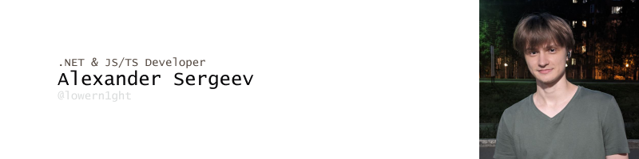

> ### **Lead Backend Engineer · System Architect · AI / Agentic Systems**

---

## About me

 - Hi, my name is Alexander — **backend developer and system architect**. I specialize on **web applications**, **high-load services** and **microservices**.
 - I take on projects **end to end**: product architecture, distributed and high-load parts, integrations with external services, developer platforms and shared libraries.
 - I also build **agentic and AI-assisted systems** — the kind of project where LLMs become a production tool, not a demo.

> Location: `Russia`

---

## Contacts

* [GitHub](https://github.com/lowern1ght)
* [Telegram](https://t.me/lowern1ght)
* Email: [lowern1ght@yahoo.com](mailto:lowern1ght@yahoo.com)

---

## Languages

* **Russian** — native
* **English** — B1 (intermediate)

---

## Skills

* **Languages:** `C#`, `TypeScript`, `Rust`, `C++`
* **Core:** `.NET`, `ASP.NET Core`, `EF Core`, `Microservices`, `System Architecture`, `DDD`
* **AI & Agents:** `LLM orchestration`, `agentic workflows`, `MCP`, `RAG`, `multi-agent systems`, `agent graphs (voluta)`, `Claude Code`, `opencode`, `Orca`
* **Data & Messaging:** `PostgreSQL`, `Kafka`, `Redis`, `ClickHouse`, `Elasticsearch`, `RabbitMQ`, `MongoDB`
* **Infra & Ops:** `Kubernetes`, `Docker`, `GitLab CI`, `Prometheus`, `Grafana`, `VictoriaMetrics`, `Keycloak`

Full stack inventory

* Frameworks & UI: `.NET Framework`, `.NET Standard`, `ASP.NET MVC`, `Avalonia UI`, `WPF`, `React`, `Node.JS`, `Bun`, `Electron.js`
* Libraries: `EF Core/6`, `Linq2DB`, `Dapper`, `MassTransit`, `Benchmark.NET`, `xUnit`, `Moq/AutoMoq`, `OpenTelemetry`, `MiniProfiler`
* Code Quality: `custom Roslyn analyzers`, `Roslyn source generators`, `.editorconfig`, `analyzer rule sets`, `code style enforcement`
* Databases & Storage: `MongoDB`, `ClickHouse`, `Redis`, `Minio`, `Amazon S3`
* Messaging & Streaming: `Kafka` (native client; consumer groups, partition replication, retention log), `RabbitMQ`, `MassTransit`
* Monitoring & Profiling: `Prometheus`, `Grafana`, `VictoriaMetrics`, `Elasticsearch`, `Kibana`, `Logstash`, `Loki`, `Zabbix`
* Web/Application Servers: `nginx`, `traefik`, `IIS`, `self-hosted`
* Orchestrators & Runtime: `Kubernetes`, `Docker Swarm`, `Podman`, `Docker`
* Tooling: `Jira`, `Confluence`, `TeamCity`, `BitBucket`, `GitLab`, `GitHub`, `Draw.io`, `Postman`, `Keycloak`
* OS: `Windows`, `Linux (Ubuntu/Fedora/CentOS)`
* Methodologies: `SCRUM`, `Kanban`, `SOLID`, `Clean Code`, `ACID`, `TDD`, `DDD`

---

## Summary

- **Lead backend & system architect — 6 years across adtech, fintech and retail, building high-load distributed systems on .NET**
- **I take products end to end: architecture and domain design, monolith decomposition, distributed and high-load parts, production environments**
- **I build agentic & AI-assisted systems — agent runtimes, orchestration and the engineering that makes LLMs part of daily delivery**
- **High bar for code quality — AI-generated and human code alike stays clean, consistent and review-ready**

---

## Work experience

> Jan 2020 - Jun 2021, Energosfera
>   * Project Role - **Middle** FullStack Developer
>   * About Company  - Largest retail company in the north in Russia
>   * About project/s - Internal CRM for management documents and transport logic
>   * Team size - 1 Project, 1 Tech Lead, 1 Team Lead, 2 - Product Managers, 8 - Developers

 * #### Task performed:
    - Architected and developed three core internal systems: a **bonus/loyalty system**, **cash register modules** and a **document routing service** supporting key retail operations.
    - Developed and maintained features for a **legacy CRM** and internal desktop applications (**Electron.js**), including integrations with retail hardware (cash registers, terminals).
    - Customized and supported **CI/CD pipelines**, networking and reverse-proxy configuration for development teams.
    - Implemented features required to comply with changing **retail legislation**, keeping company operations compliant.

 * #### Company stack: 
   - `C#`, `.NET Core`, `.NET Framework`, `Dapper`, `EFCore`, `JS/TS`, `React`, `Electron.JS`, `Docker`, `Prometheus/Grafana`, 
`Zabbix`, `PostgreSQL`, `Redis`, `RabbitMQ`, `Elasticsearch`, `Kibana`

---

> Jul 2021 - Feb 2022, Meridian Payments
>   * Project Role - **Senior Backend Developer**
>   * About Company  - Fintech startup building a card-not-present payment gateway and billing platform
>   * About project/s - Payment processing, recurring billing, fraud detection and acquiring integrations
>   * Team size - 1 Tech Lead, 2 Product Managers, 6 Backend, 2 Frontend, 1 DevOps

* #### Task performed:
    - Designed and built the **core payment gateway** (.NET Core, PostgreSQL) processing card-not-present transactions with idempotency keys and exactly-once delivery semantics.
    - Implemented a **real-time anti-fraud pipeline** (Kafka, Redis) — heuristics + velocity rules that cut chargeback rate significantly within the first quarter.
    - Built the **recurring billing engine** handling subscriptions, proration and dunning flows for SaaS merchants.
    - Integrated with **external acquirers and PSPs** (3-D Secure, tokenization, webhooks) — standardized adapter layer so new providers shipped in days, not weeks.
    - Owned **PCI DSS compliance** for the backend layer — no plain PAN storage, strict key management, audit-ready logging.
    - Shipped services on **Kubernetes** with full **OpenTelemetry** tracing and Prometheus metrics.

* #### Company stack:
    - `C#`, `.NET Core`, `EF Core`, `PostgreSQL`, `Kafka`, `Redis`, `Docker`, `Kubernetes`, `Prometheus/Grafana`, `OpenTelemetry`, `xUnit`

---

> Mar 2022 - **For now**, Hybrid.ai
>   * Project Role - **Lead Senior Backend Developer**, **System Architect**
>   * About Company  - Marketing company, ranked 3rd in the world. Provides a complete package of necessary for opening and advertising on sites
>   * About project/s - CRM, DSP, SSP, Big Data statistic, more feature for marketing life, integration with popular solutions and advertising world supplier
>   * Team size - 1 Project, 4 Team Lead, 1 - System Architect, 8 - Product Managers, 16 - Backend, 14 - Frontend

* #### Task performed:
    - Conceived and built the product's **MCP layer**: an MCP gateway exposing the API as agent tools, generated from the API clients by a **Roslyn source generator** I wrote — replacing 88 hand-written wrappers; any drift between API and agent surface now fails the build.
    - Designed the **agentic contour end to end**: agent runtime (CLI, web dashboard, audit trail), **skill system**, **workflow orchestration** and **quality gates** — plus an **in-house orchestrator** that turns **Jira** tasks into code with **self-verification** loops and upfront **dollar-cost estimates**. The harness layer runs on **voluta** — a **LangGraph-style agent-graph engine for .NET** I authored (open source); **two production harnesses** are built on it.
    - **Decomposed a 7-year-old core monolith** into a **modular core + BFF system** with **deep DDD and a plugin system**; product teams extend it through a **multi-agent toolchain (Claude Code, opencode, the in-house coding agent)** orchestrated in **Orca**, while engineering owns the surrounding fleet of **20–30 microservices**.
    - Designed and built a **notification service handling 50k rps** at launch with horizontal scaling headroom, and **custom DSL parsers** letting teams express filtering, rules and domain queries declaratively; maintained the **internal shared libraries** every product builds on.
    - Introduced **AI-assisted development** into daily delivery, backed by **guardrails for agent-generated code** — custom **Roslyn analyzers**, strict `.editorconfig`, rule sets and a self-verifying **verification harness** (`hermes`).
    - Built an internal **job orchestration & monitoring system** (web UI, **Keycloak** auth) and an **exception hierarchy** splitting business vs technical errors for faster, better-diagnosed support.
    - Managed a **team of 4** refactoring legacy modules and extracting satellite microservices; owned **observability** (Grafana/Kibana dashboards, **VictoriaMetrics**, **Elastic**) and set up **Kubernetes** production/dev environments with monitoring.

* #### Company stack:
    - `C#`, `.NET Core`, `.NET Framework`, `Dapper`, `EFCore`, `Linq2Db`, `MassTransit`,
      `Kafka`, `Redis`, `RabbitMQ`, `JS/TS`, `xUnit`, `MSUnit`, `Benchmark.NET`,
      `React`, `Docker`, `Kubernetes`, `Nginx`, `IIS`, `JMeter`, `Ansible`, `Loki`, `Proxmox`, `Amazon S3`, `Minio`, 
      `Prometheus/Grafana`, `VictoriaMetrics`, `Zabbix`, `PostgreSQL`, `MongoDB`, `Elasticsearch`, `Kibana`, `Keycloak`,
      `Claude / LLM`, `MCP`, `agentic orchestration`, `Roslyn source generators`, `voluta`, `opencode`, `Orca`, `Bun`, `TypeScript`

---

## Projects

* [**voluta**](https://github.com/dot-stbl/voluta) — *open source* — my own **agent-graph engine for .NET**: LangGraph-style, but .NET-native. Stateful, cyclic, durable graphs with typed channels, Pregel-style supersteps, checkpoints, streaming and human-in-the-loop. Published on NuGet under my org [dot-stbl](https://github.com/dot-stbl).
  * Cycles not DAGs; a thread can pause for days and resume in another process.
  * **Two production agent harnesses** at Hybrid.ai are built on it.

* [**notifliwy**](https://github.com/dot-stbl/notifliwy) — *open source* — my own **.NET library**: a distributed handler & pipeline for **notifications**, built for event-driven architectures with a fluent builder API. Published under my org [dot-stbl](https://github.com/dot-stbl).
  * Composable processing pipeline (input → connector → conditions → mapper → exporter), fully async with **DI** integration.
  * Pluggable transport providers (**Kafka** / **MassTransit**), built-in metrics and **OpenTelemetry** diagnostics.

* **Real-time crypto analytics & trading platform** — *private, self-hosted* — a personal platform that ingests and processes **~150k events/sec from 17 exchanges** and exposes unified market analysis and automated trading.
  * High-throughput event pipeline with low-latency aggregation across heterogeneous exchange feeds.
  * Source kept in a self-hosted Git; not public — details and walkthrough available on request.

* **Self-hosted home ecosystem** — *private* — a suite of personal services and automation I design, build and run on my own infrastructure.

---

## Education

> Nefteugansk's Technology College
>   * Faculty - Production